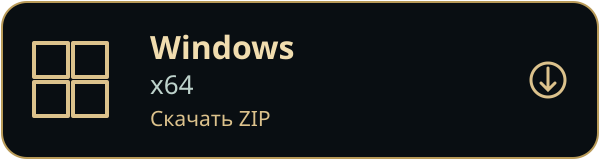
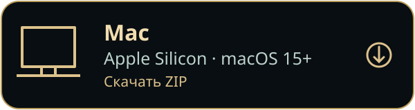
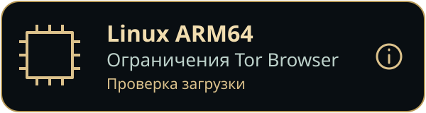
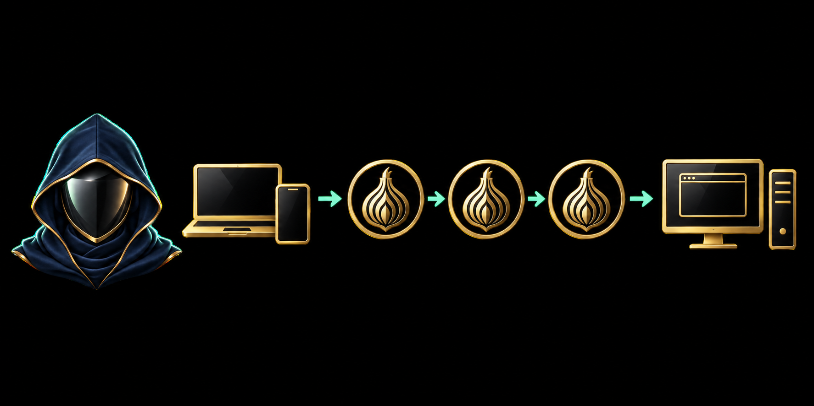
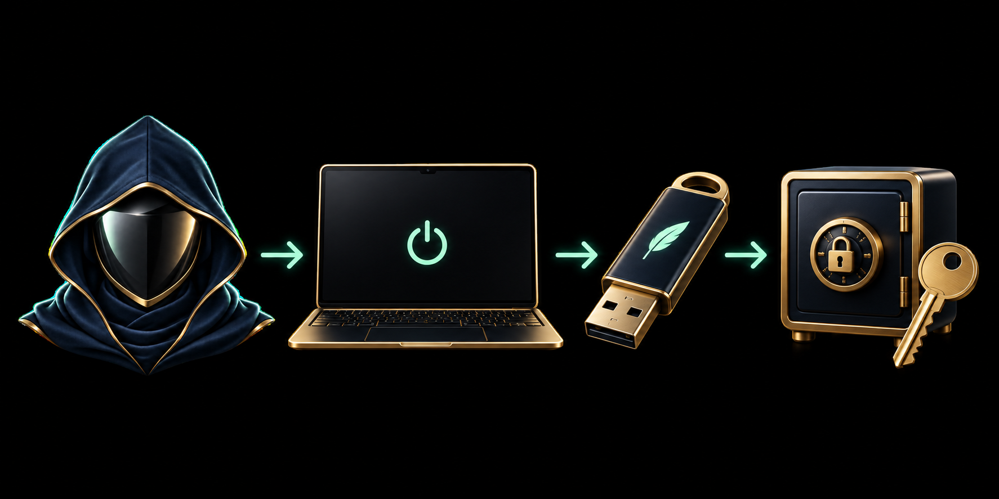
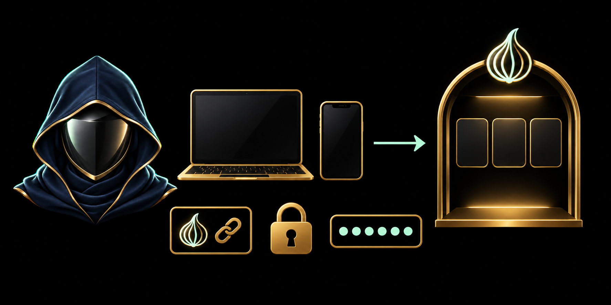

  

<h1 align="center">Ваш отдельный рабочий стол. Понятный путь к нему.</h1>

Мастер подготовки Tor, кошелька, флешки Tails и удалённого кабинета. Бесплатный комплект · русский интерфейс · закрытый предварительный выпуск

## Программа для вашего компьютера

Новые комплекты для запуска одним нажатием ещё не опубликованы. Выберите **систему компьютера, на котором будете открывать мастер**, чтобы посмотреть текущий статус и порядок первого запуска. Ссылки появятся после публикации и проверки; запуск через графический интерфейс на всех четырёх системах пока не подтверждён.

  
  
   
  
  

**Linux ARM64:** OnionDesk можно открыть для подготовки и просмотра инструкций. В этом выпуске этап с официальным Tor Browser недоступен. Для полного маршрута используйте компьютер Intel/AMD x86-64 или поддерживаемый Mac.

Для закрытого выпуска нужен аккаунт GitHub с доступом к этому репозиторию. Полный комплект рассчитан на запуск готовой программы без Python и самостоятельной сборки. Материалы для знакомства уже опубликованы в выпуске v5. [Первое открытие и ограничения каждой ОС](docs/DOWNLOADS.md).

## 01 · Что это за сервис

> **Агент:** «Рабочий стол находится на отдельном компьютере, который вы арендуете. Его экран вы открываете со своего ноутбука или телефона».

OnionDesk ведёт по настройке этого доступа через Tor. На удалённой стороне используются раздельные среды Whonix для соединения и работы. Сервер арендуется отдельно: программа не покупает его и не создаёт оплаченный кабинет за вас.

## 02 · Что мы подготовим вместе

> **Агент:** «Сначала откройте мастер на обычном компьютере. Я покажу одно действие, ожидаемый результат и помощь, если у вас другой экран».

1. **Соединение и доступ.** Подготовим Tor и проверим подключение.
2. **Кошелёк и резервная копия.** При необходимости создадим кошелёк; вы сохраните секретные слова отдельно.
3. **Флешка и сервер.** Проверим совместимость, подготовим Tails USB и перейдём к установке удалённого кабинета.

Оплату, стирание выбранной флешки и разрешения телефона подтверждает владелец. Мастер объясняет действия, показывает результаты текущих проверок и сообщает об обнаруженных ошибках. [Что понадобится до начала](GUIDE.md).

## 03 · Как входить потом

> **Агент:** «Каждый день устанавливать всё заново не нужно. Откройте Tor, свой адрес кабинета и войдите с сохранёнными данными доступа».

Для Windows, Mac, Linux, Tails, Android и iPhone предусмотрены отдельные подсказки. Телефон служит для доступа к уже подготовленному кабинету; настольный мастер на него не устанавливается. Подготовка Android по USB требует подтверждения доверия на экране телефона.

## Сайты, Monero и расходы

- **[Открывать сайты и входить в свои аккаунты](docs/WEBSITES.md)** — какой браузер запустить внутри кабинета и что Tor действительно скрывает.
- **[Обменять USDT на XMR](docs/MONERO-USDT.md)** — сеть, адрес кошелька, пробный обмен и результат каждого действия.
- **[Посчитать первый месяц и продление](docs/BUDGET.md)** — основной пример около 101 USDT в месяц, первый месяц около 116 USDT; комиссии отдельно.

## Посмотреть и разобраться

**[Открыть выпуск v5 с видео и PDF](https://github.com/lindwerg/oniondesk/releases/tag/preview-2026.10.16-v5)**

В закрытом предварительном выпуске v5 опубликованы обновлённые видео, презентация и руководство для участников репозитория. Все шесть вложений повторно скачаны из GitHub: размеры и контрольные суммы совпали с подготовленными файлами.

- **[Видеоинструкция](https://github.com/lindwerg/oniondesk/releases/download/preview-2026.10.16-v5/OnionDesk-video-guide.mp4):** 23 мин 54 с, 105 иллюстрированных сцен без озвучки; текст виден в кадре. Отдельно доступны [русские субтитры SRT](https://github.com/lindwerg/oniondesk/releases/download/preview-2026.10.16-v5/OnionDesk-video-guide.srt) и [список глав](https://github.com/lindwerg/oniondesk/releases/download/preview-2026.10.16-v5/OnionDesk-video-chapters.txt). Это учебная демонстрация; она не выдаёт синтетические состояния за испытания оплаченного сервера.
- **[Презентация](https://github.com/lindwerg/oniondesk/releases/download/preview-2026.10.16-v5/OnionDesk-presentation-2026-10-16.pdf):** тот же маршрут в 105 статичных слайдах для спокойного просмотра.
- **[Руководство со снимками](https://github.com/lindwerg/oniondesk/releases/download/preview-2026.10.16-v5/OnionDesk-guide.pdf):** 260 страниц с действиями, вариантами устройств и помощью при другом результате. Сайты — со страницы 244, обмен USDT → XMR — с 249, бюджет — с 256.

Для проверки полученных материалов доступны [контрольные суммы SHA-256](https://github.com/lindwerg/oniondesk/releases/download/preview-2026.10.16-v5/SHA256SUMS-media.txt).

## Установить и открыть

Следующие действия относятся к **полностью полученному и проверенному комплекту**. Новые комплекты для запуска одним нажатием ещё не опубликованы; полная проверка первого открытия на всех четырёх системах не завершена. Частичный архив запускать нельзя.

| Ваш компьютер | Что открыть после полной распаковки ZIP |
|---|---|
| Windows x64 | `OnionDesk-Windows.exe`, затем созданный ярлык OnionDesk |
| Mac Apple Silicon, macOS 15+ | `OnionDesk.app`; порядок первого открытия — в [инструкции для Mac](docs/DOWNLOADS.md#macos) |
| Linux Intel / AMD x64 | `OnionDesk-Linux-x64`; для Tor Browser нужен обычный Linux Desktop с GTK3 |
| Linux ARM64 | `OnionDesk-Linux-ARM64` — подготовка и инструкции; этап Tor Browser на этой архитектуре недоступен |

Сохраняйте комплект целиком. Папка `.oniondesk` рядом с Windows- и Linux-программами содержит необходимые ресурсы и может быть скрыта проводником. В Mac-приложении ресурсы встроены. **Файлы исходного кода в верхней части GitHub для установки не нужны.**

<strong>Статус экспериментального получения через CLI</strong>

Ранее подготовленные distribution-ветки остаются экспериментальными. Пользовательские ссылки появятся после публикации и проверки новых комплектов для запуска одним нажатием. Инструкции для разработчиков находятся в [описании нативной сборки](client/BUILD-NATIVE.md).

## Доверие и состояние выпуска

Tor, разделение сред и локальные проверки уменьшают конкретные риски. Полную анонимность и отсутствие всех уязвимостей они не гарантируют. Пароли, слова кошелька и одноразовые коды не отправляйте в Issues и отчёты.

Это **предварительный выпуск**. Настоящие оплаченный сервер и SMS, физическая загрузка USB на всех ОС, полный путь Android/iPhone и системные разрешения каждой ОС ещё не подтверждены во всех вариантах. Mac имеет локальную подпись ad-hoc, без Apple notarization; готового Mac Intel нет. На Linux необходимы графический рабочий стол, браузер и glibc 2.36+. [Проверки и их границы](docs/VERIFICATION.md) · [Модель угроз](docs/THREAT-MODEL.md).

Для разработчиков: исходники, архитектура и лицензии

[Архитектура](docs/ARCHITECTURE.md) · [Разработка](docs/DEVELOPMENT.md) · [Участие](CONTRIBUTING.md) · [Безопасность](SECURITY.md) · [Лицензии сторонних компонентов](docs/LICENSES.md).

Собственная лицензия проекта этим описанием не меняется. Сторонние компоненты сохраняют свои условия. Изображения служат иллюстрациями, а не доказательствами проверки сервера, оплаты или наличия средств.

