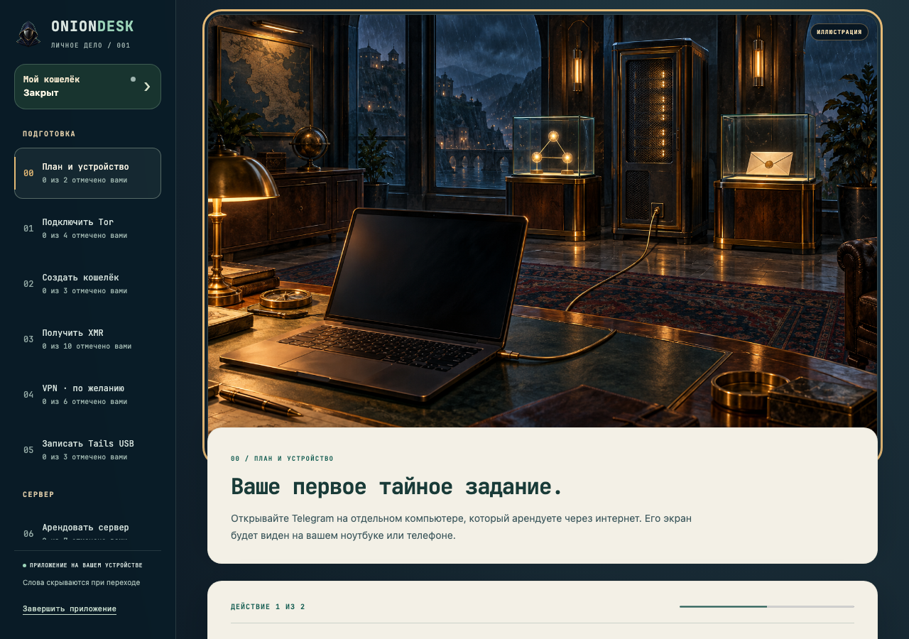
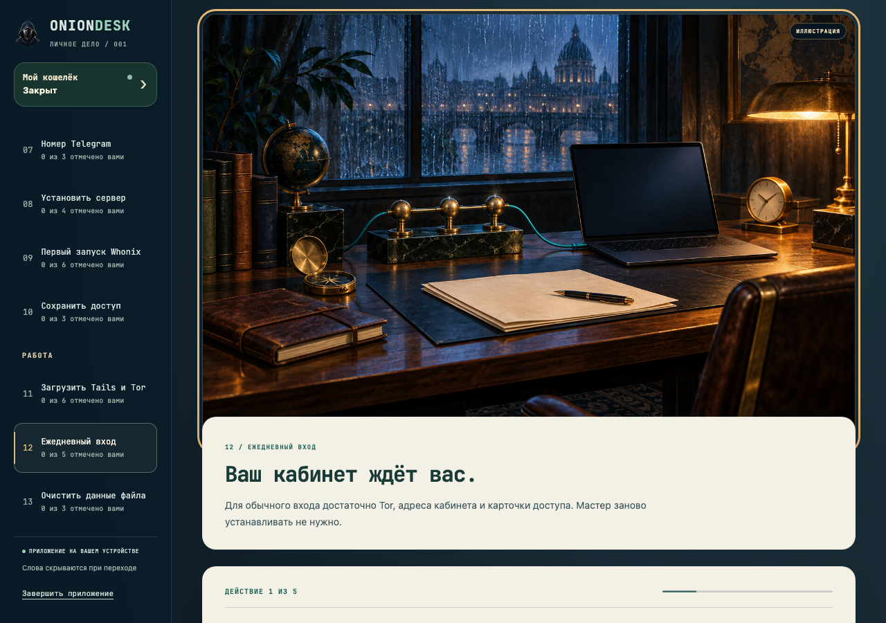
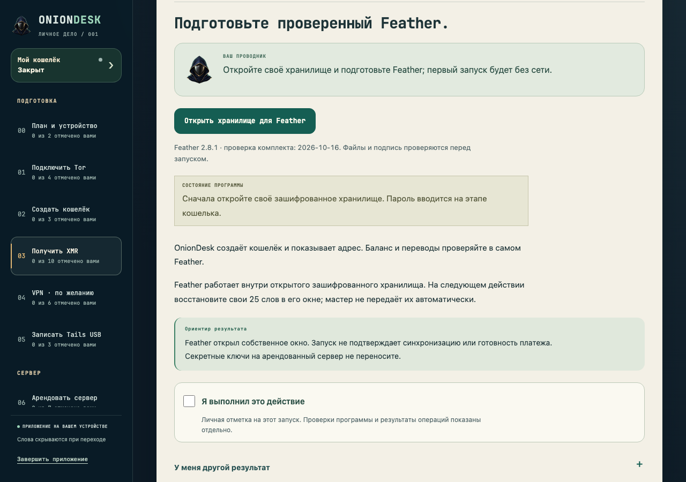

<h1 align="center">OnionDesk</h1>

<strong>Личный кабинет через Tor. Понятный маршрут от подготовки до ежедневного входа.</strong>

Закрытая предварительная версия · русский интерфейс · Windows / macOS / Linux

OnionDesk помогает подготовить отдельный удалённый рабочий стол, подключаться к нему через Tor и сохранять контроль над доступом. Мастер ведёт по отдельным действиям: Tor, локальный кошелёк Monero, проверенный Tails USB, настройка Whonix на сервере, сохранение доступа и ежедневная работа с компьютера или телефона.

Это **private preview**. Исходники подготовлены для проверки; готовый релиз ещё не опубликован. Иллюстрации ниже сняты с синтетического демонстрационного состояния и не подтверждают работу реального сервера, оплату или наличие средств.

  <a href="docs/DOWNLOADS.md#windows"><strong>Windows x64 · готовится</strong></a> &nbsp; • &nbsp;
  <a href="docs/DOWNLOADS.md#macos"><strong>macOS Apple Silicon · готовится</strong></a> &nbsp; • &nbsp;
  <a href="docs/DOWNLOADS.md#linux"><strong>Linux · готовится</strong></a>

Кнопки сейчас открывают статус соответствующего пакета. После проверки они будут вести на полный ZIP нужной ОС в закрытом GitHub, открываемый через браузер с доступом к проекту. Python, терминал и самостоятельная сборка получателю готового приложения не нужны. [Как будет устроена установка](GUIDE.md) · [Требования и ограничения платформ](docs/DOWNLOADS.md).

## Что внутри

| Возможность | Как это работает |
|---|---|
| Пошаговый проводник | 14 этапов, отдельные действия, ожидаемый результат и помощь при другом экране. Отметки действий не заменяют техническую проверку. |
| Удалённый рабочий стол | Раздельные Whonix Gateway и Workstation, onion-вход через Tor, пароль и одноразовый код. |
| Кошелёк Monero | Создание офлайн, проверка защищённого хранилища и резервной фразы; переводы подтверждает владелец в совместимом кошельке. |
| Tails USB | Проверка официального образа и подписи, выбор носителя, отдельное подтверждение стирания, проверка записи. |
| Телефон | Инструкции для Android и iPhone; подготовка Android по USB требует личного подтверждения доверия и последующего отключения отладки. |
| Очистка метаданных | Создание проверенных копий в гостевой Workstation с сохранением исходников; содержимое документа всё равно требует проверки человеком. |
| Повседневный вход | Отдельные подсказки для Windows, macOS, Linux, Tails, Android и iPhone. |

## Начать

1. Выберите пакет своей ОС на [странице загрузок](docs/DOWNLOADS.md). До появления проверенного релиза загрузка помечена как недоступная.
2. Полностью распакуйте комплект или откройте установщик. Сохраняйте поставляемые папки вместе с программой.
3. Откройте OnionDesk и следуйте мастеру. Действия с оплатой, паролями, резервной фразой, USB и доверенным устройством подтверждаете вы.
4. Сохраните карточку доступа и резервную копию до перезагрузки в Tails. Для повседневного входа мастер заново устанавливать не требуется.

Подробнее: [руководство пользователя](GUIDE.md) · [восстановление](docs/RECOVERY.md).

## Доверие и границы

Tor, разделение виртуальных машин и локальные защитные проверки уменьшают конкретные риски. Они не обещают полную анонимность, отсутствие уязвимостей или безопасность заражённого компьютера. Личные аккаунты, платёжные следы, аппаратное обеспечение и внешние сервисы остаются отдельными границами доверия.

В этой стадии не заявлены завершённая установка на оплаченный KVM-сервер, настоящая запись USB на всех ОС, полная проверка UAC/polkit и гарантированная регистрация Telegram/SMS. Wine, эмулятор и Docker имеют собственные пределы. [Модель угроз](docs/THREAT-MODEL.md) · [матрица проверок](docs/VERIFICATION.md).

## Для разработчика

Исходники клиента, сервера, шлюза входа и тестов находятся в этом репозитории. Большие официальные образы, исполняемые пакеты, личные хранилища и необработанные доказательства проверок в Git не включаются. Полная сборка требует проверенного набора ресурсов; её текущие ограничения описаны отдельно.

[Архитектура](docs/ARCHITECTURE.md) · [разработка и воспроизведение](docs/DEVELOPMENT.md) · [план релиза](docs/RELEASE-PLAN.md) · [планы](docs/ROADMAP.md) · [участие](CONTRIBUTING.md) · [сообщить о проблеме безопасности](SECURITY.md) · [лицензии](docs/LICENSES.md).

English overview

OnionDesk is a private preview of a guided desktop toolkit for preparing a Tor-accessible remote workspace, an offline Monero wallet, verified Tails USB media and device-specific access instructions. Native release downloads are pending verification. No claim of complete anonymity or universal platform validation is made. Original code licensing is unchanged; bundled third-party notices retain their own terms.

