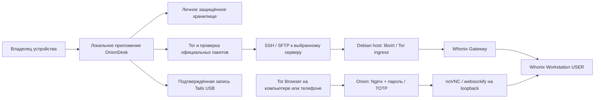

# Архитектура

| Каталог | Ответственность |
|---|---|
| `client/app.py`, `launcher.py`, `start_app.py` | Локальный процесс, API и запуск интерфейса. |
| `client/ui` | Интерфейс, локальные шрифты, понятные шаги и состояния операций. |
| `client/usb_*` | Проверка образа Tails, подтверждение цели и отдельный привилегированный helper. |
| `client/wallet_*`, `feather_*` | Публичный каталог, проверка официальных пакетов, локальный кошелёк и управление хранилищем. |
| `client/phone_*` | Закреплённые Android-компоненты, USB и проверка устройства. |
| `client/offline_*` | Проверка разрешённых файлов большого офлайн-комплекта. |
| `server` | Подготовка Debian/KVM, валидация официальных гостевых образов, разделение USER/SYSMAINT, runtime-аудит и очистка копий файлов. |
| `frontend` | Onion-only Nginx, аутентификация, TOTP и защита WebSocket входа. |
| `tests/docker` | Unit-тесты, отдельные сценарии браузера, шлюза и гостевых образов. |

Локальный интерфейс общается с приложением через loopback API с проверками Host, Origin и nonce. Нативное окно использует приватный режим без прикладного Python bridge. Backend и UI имеют разные обязанности: UI показывает результат, backend подтверждает ограничения и выполняет действие. Изменение надписи в UI не является проверкой результата.

Удалённые VM и loopback listeners имеют проверяемую топологию. USER служит для повседневной работы, SYSMAINT — для обслуживания. Авторизация web-входа не превращает сам noVNC в средство обмена пользовательскими файлами.

Секреты владельца, содержимое кошелька, серверные ключи и большие официальные образы не входят в Git. Точные контракты находятся в [контракте клиента](../client/APP-CONTRACT.md), [USB](../client/USB-CONTRACT.md) и [сервера](../server/CONTRACT.md). Это описание устройства системы, а не доказательство завершённой production-проверки.
