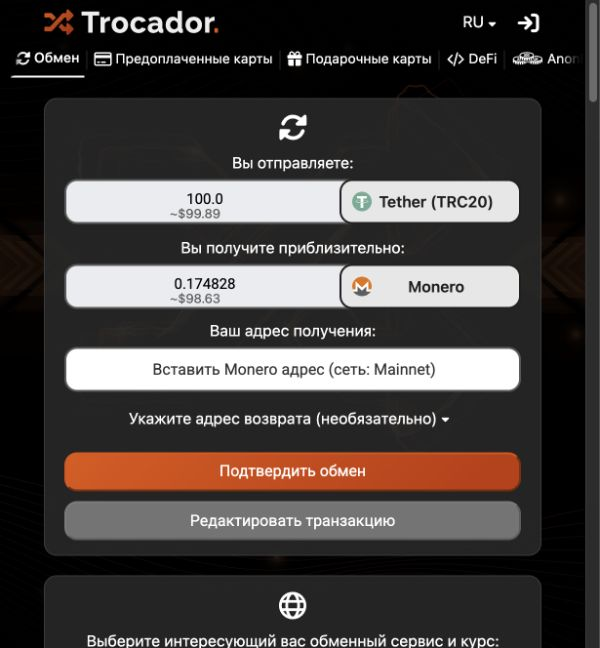

# У меня USDT. Как получить Monero

Актуальность: 16 октября 2026 года. Для уже созданного кошелька OnionDesk.

> **Вы:** «Кошелёк готов, но у меня USDT, а нужен XMR».
>
> **Агент:** «Возьмём ваш адрес получения в Feather, сравним обмен и начнём с отдельной небольшой заявки. Перевод подтверждаете вы».

## До пополнения: проверьте резервную копию

**Сохраните и проверьте 25 слов восстановления в мастере.**
Результат: резервная фраза хранится у вас отдельно, а проверка сохранённых слов завершена. Пока это не сделано, не переводите деньги в кошелёк. [Как сохранить и восстановить доступ](RECOVERY.md).

## 1. Получите свой адрес XMR

1. **Откройте существующий кошелёк в официальном Feather из комплекта.**
   Результат: кошелёк открыт вашим паролем. Создавать второй кошелёк для обмена не требуется.

2. **Откройте вкладку Receive — «Получить».**
   Результат: виден ваш адрес получения Monero в основной сети, mainnet. [Инструкция Feather](https://docs.featherwallet.org/guides/receive-transaction).

3. **Скопируйте адрес получения.**
   Результат: у вас есть адрес для зачисления XMR. Это не 25 секретных слов.

**25 английских слов хранятся только у вас.** Их нельзя вводить на сайте обмена, отправлять поддержке или публиковать в GitHub. Открытый адрес получения не заменяет резервную копию.

## 2. Разберитесь, в какой сети ваши USDT

4. **Посмотрите сеть USDT в кошельке или на странице вывода вашей биржи.**
   Результат: вы точно знаете сеть. Например, TRC20, ERC20 и BSC — разные варианты; название USDT само по себе недостаточно.

5. **Проверьте стоимость отправки в источнике USDT.**
   Результат: понятны комиссия и сумма, которая действительно придёт обменнику. В собственном кошельке для оплаты сети могут потребоваться TRX/ресурсы, ETH или BNB; на бирже проверяют её комиссию вывода.

**Остановитесь, если сеть или сумма после комиссии непонятны.** Выбор TRC20 в примере не означает, что ваши USDT находятся в TRC20.

## 3. Сравните обмен

6. **Откройте [Trocador](https://trocador.app/ru/).**
   Результат: открыт отдельный сайт сравнения обменов. Встроенное подключение Trocador к Feather здесь не подтверждено.

7. **Выберите отправку USDT в своей сети и получение Monero, XMR.**
   Результат: сеть отправки совпадает с сетью ваших средств, а получаемая монета — XMR.

8. **Укажите сумму для предварительного расчёта.**
   Результат: видны доступные предложения. Сумма 100 USDT на снимке ниже — только пример формы, а не минимум, рекомендация, ваш баланс или фиксированная цена.

При проверке 16 октября 2026 года были открыты публичная форма и котировки для 100 USDT TRC20 → XMR. Адрес получения оставался пустым; заявку не создавали, деньги не отправляли.

9. **Сравните итоговое количество XMR у подходящих партнёров.**
   Результат: вы сравниваете сумму к получению с учётом показанных удержаний, а не только привлекательный курс.

10. **Прочитайте условия выбранного партнёра.**
    Результат: понятны минимум, срок оплаты, условия возврата, требования AML/KYC и доступность для вашей страны. Начните с [описания Trocador](https://trocador.app/en/about/) и [условий сервиса](https://trocador.app/en/termsofuse/).

**Остановитесь до отправки денег**, если возврат вас не устраивает, регион недоступен или вы не готовы к возможной проверке личности. Обмен через Trocador не гарантирует отсутствие KYC: партнёр может приостановить заявку и запросить документы.

**Если заполняете «Адрес возврата», укажите свой адрес для получения USDT в той же сети, из которой отправляете деньги.** Например, для USDT TRC20 нужен адрес получения USDT TRC20 под вашим контролем. Адрес XMR из Feather сюда не подходит. Поле может быть необязательным, но условия возврата выбранного партнёра всё равно нужно понять до оплаты.

## 4. Проведите отдельный небольшой тест

11. **Запросите новый расчёт для небольшой тестовой суммы выше минимума выбранного партнёра.**
    Результат: это самостоятельный тестовый обмен с актуальной котировкой. Размер теста выбираете вы с учётом минимума и комиссий.

12. **Вставьте адрес из Receive и сверьте весь адрес с Feather.**
    Результат: в заявке указан именно ваш mainnet-адрес XMR.

13. **Лично подтвердите создание тестовой заявки на сайте.**
    Результат: сайт показывает реквизиты конкретной заявки, сумму и время для оплаты. Если экран отличается от ожидаемого или условия изменились — остановитесь.

14. **Лично отправьте USDT по реквизитам этой заявки.**
    Результат: вы отправляете указанную сумму в указанной сети в пределах срока оплаты. Перед подтверждением ещё раз проверьте сеть, адрес и фактическую сумму зачисления после комиссии вывода.

15. **Сохраните номер заявки и идентификатор перевода, TXID, приватно.**
    Результат: есть данные для проверки статуса или обращения к выбранному партнёру. В GitHub их не публикуют.

16. **Дождитесь зачисления в синхронизированном Feather.**
    Результат: входящий XMR виден в вашем кошельке. Если срок заявки истёк или статус непонятен, сначала проверьте заявку и её правила; повторно деньги не отправляйте наугад.

17. **Создайте новую заявку для оставшейся суммы после успешного теста.**
    Результат: остаток имеет собственные актуальные условия и реквизиты. Одну заявку нельзя делить на тест и последующую доплату; старые реквизиты повторно не используют.

## Если основной сайт не подходит

Запасной вариант для **USDT именно в TRC20** — [страница ChangeNOW USDT TRC20 → XMR](https://changenow.io/currencies/tether-trc20/monero). Перед заявкой прочитайте [правила AML/KYC](https://changenow.io/terms-of-use/aml-kyc), региональные ограничения и возврат. Доступность для вашей страны не подтверждена. Для ERC20 или BSC эта ссылка не подходит.

> **Вы:** «После обмена исчезнет история USDT?»
>
> **Агент:** «Нет. Публичная история USDT и записи обменного сервиса сохраняются. XMR не стирает прошлые операции».

Дальше: [посчитать бюджет](BUDGET.md) · [вернуться к основному руководству](../GUIDE.md).
